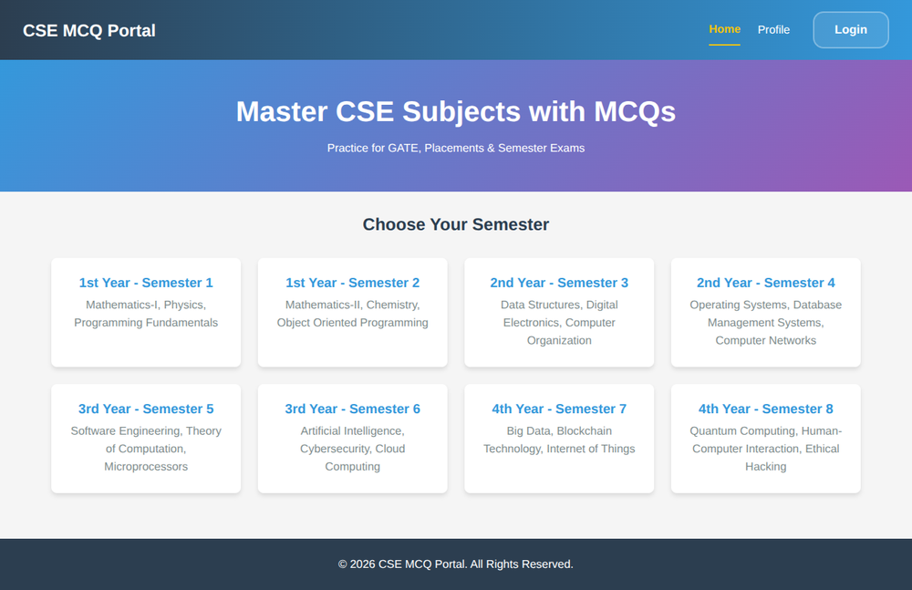
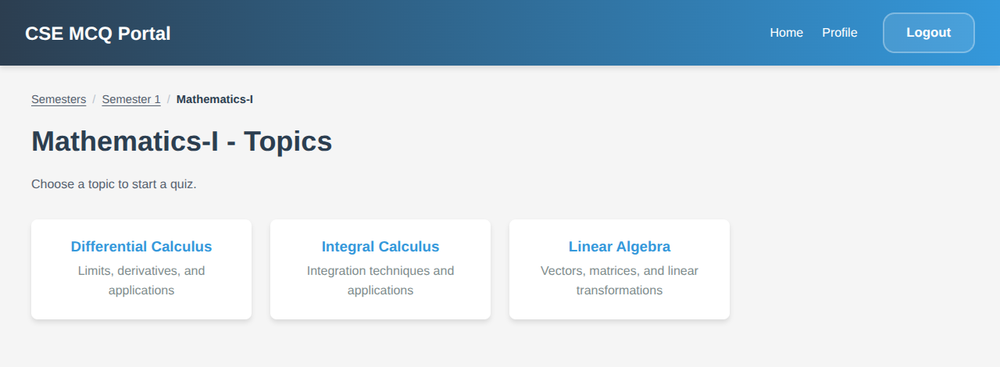
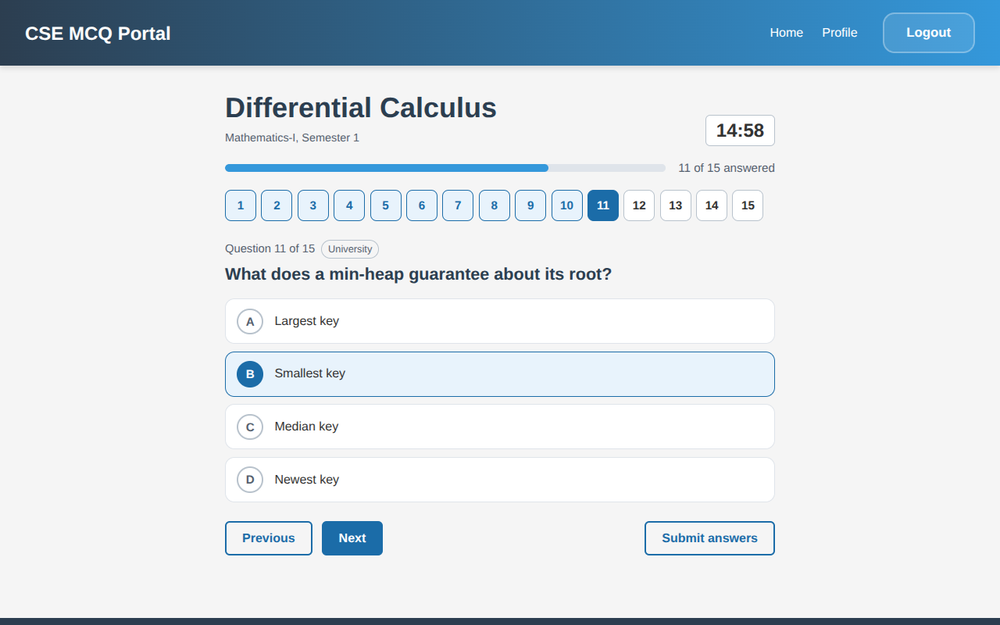
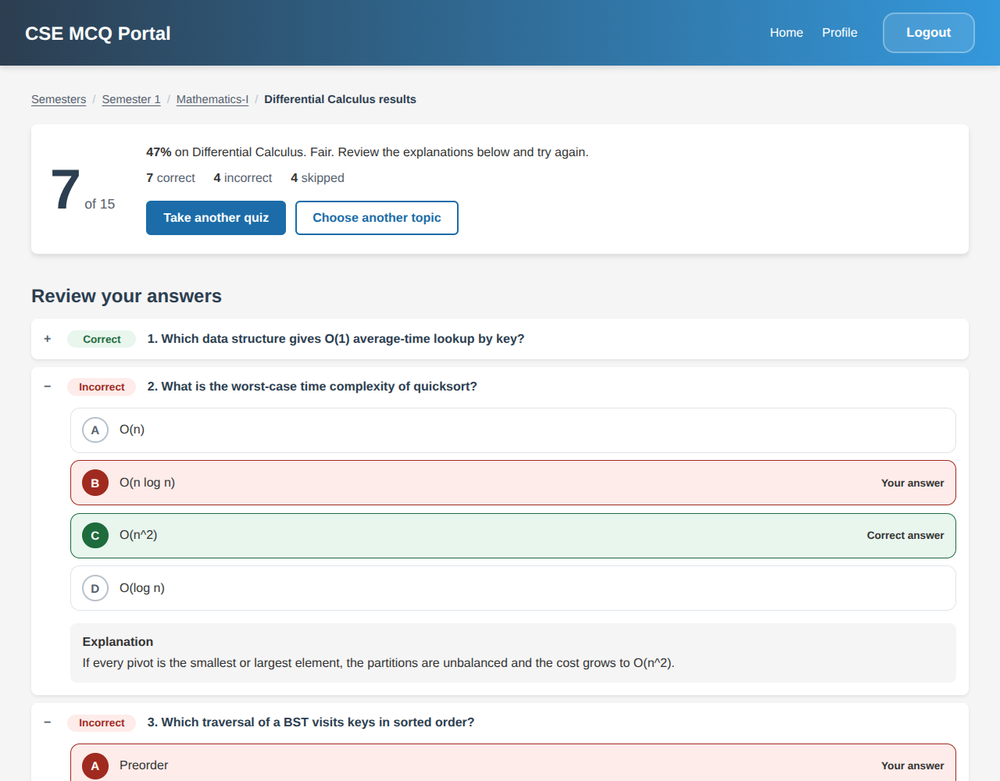
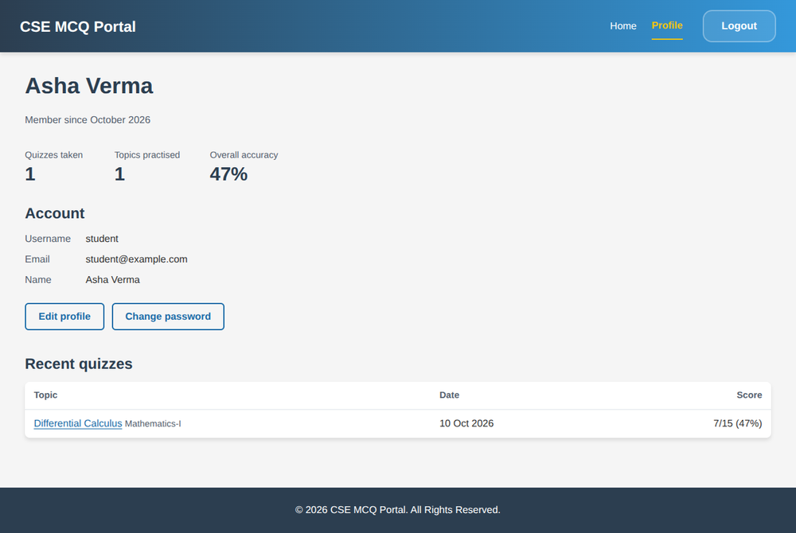
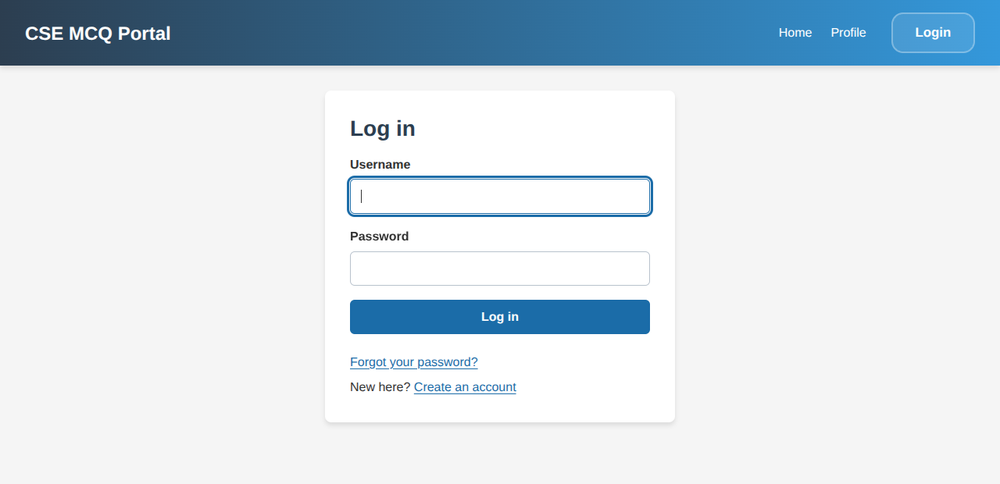
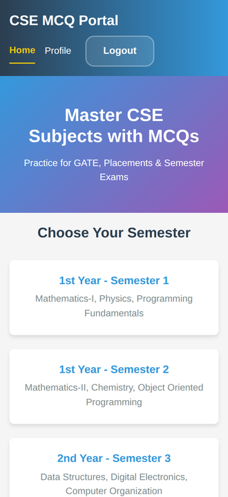

# CSE MCQ Portal

A Django web app for practising Computer Science multiple-choice questions. Pick a semester, subject and topic, and the app asks Google Gemini to write a fresh 15-question quiz. You take it against a timer, then review every answer with an explanation.

## Screenshots

| Home | Topics |
|---|---|
|  |  |

| Taking a quiz | Results and review |
|---|---|
|  |  |

| Profile | Login | Mobile |
|---|---|---|
|  |  |  |

## Features

- Sign up, log in, edit your profile, change or reset your password
- 8 semesters, 24 subjects and 72 topics included (easy to edit)
- AI-generated questions at GATE, university and interview level
- Timed quiz with a question palette and a "submit with unanswered questions?" prompt
- Instant review with the correct answer and an explanation for every question
- Attempt history and overall accuracy on your profile
- Responsive layout that works on phones

## Tech stack

Python 3.10+, Django 5.2, SQLite, Google Gemini (`google-genai`), plain HTML, CSS and JavaScript (no frontend framework).

## Getting started

You need Python 3.10 or newer and a free Gemini API key from <https://aistudio.google.com/apikey>.

**1. Get the code**

```bash
git clone <your-repo-url> mcq_quiz
cd mcq_quiz
```

**2. Create a virtual environment and install packages**

```bash
python -m venv venv
source venv/bin/activate          # Windows PowerShell: venv\Scripts\Activate.ps1
pip install -r requirements.txt
```

**3. Create your settings file**

```bash
cp .env.example .env              # Windows PowerShell: copy .env.example .env
```

Open `.env` and fill in two values:

- `DJANGO_SECRET_KEY`: generate one with
  `python -c "from django.core.management.utils import get_random_secret_key as g; print(g()+g())"`
- `GEMINI_API_KEY`: your key from Google AI Studio

Keep `DJANGO_DEBUG=True` for local use. Never commit `.env` to Git.

**4. Set up the database and run**

```bash
python manage.py migrate
python manage.py import_data          # loads the semesters, subjects and topics
python manage.py createsuperuser      # optional, for the /admin/ site
python manage.py runserver
```

Open <http://127.0.0.1:8000/>, sign up, choose a semester and topic, and click **Start quiz**.

## Configuration

Settings come from environment variables or the `.env` file.

| Variable | Required | Default | Purpose |
|---|---|---|---|
| `DJANGO_SECRET_KEY` | yes | none | Signs sessions and password-reset links |
| `GEMINI_API_KEY` | yes | none | Used to generate questions |
| `DJANGO_DEBUG` | no | `False` | Set to `True` for local development |
| `GEMINI_MODEL` | no | `gemini-flash-latest` | Change this if Google retires the model |
| `QUIZ_QUESTION_COUNT` | no | `15` | Questions per quiz |
| `QUIZ_TIME_LIMIT_SECONDS` | no | `900` | Quiz timer |
| `QUIZ_GENERATE_LIMIT` | no | `10` | New quizzes per user per hour |
| `EMAIL_HOST` and related | no | prints to console | SMTP settings for password-reset emails |

See `.env.example` for the full list.

## Running the tests

```bash
DJANGO_DEBUG=True python manage.py test        # PowerShell: $env:DJANGO_DEBUG="True"; python manage.py test
```

The tests mock Gemini, so they need no API key and no internet access.

## Project structure

```
mcq_quiz/      Project settings, URLs and security middleware
accounts/      User model, login, signup, profile and password pages
mcq_app/       Semesters, subjects, topics, quiz flow and the Gemini service
templates/     Base layout, error pages and password-reset pages
static/        site.css, app.js and the favicon
docs/          Screenshots used in this README
subjects.json  Semester, subject and topic data loaded by import_data
```

To change the curriculum, edit `subjects.json` and run `python manage.py import_data` again. It adds and updates entries but never deletes them; remove old ones in the admin site.

## Troubleshooting

| Problem | Fix |
|---|---|
| `DJANGO_SECRET_KEY is not set` | Create `.env` from `.env.example` and fill in the key |
| "Quiz generation isn't set up" | `GEMINI_API_KEY` is missing from `.env` |
| "We couldn't reach the question generator" | Check the terminal for the real error. It is usually an invalid key or a retired model, so set `GEMINI_MODEL`. |
| PowerShell won't activate the venv | Run `Set-ExecutionPolicy -Scope CurrentUser RemoteSigned` once |
